As a ML engineer, when I started working with time series modelling, popularity of `ARIMA` and similar class of algorithms/models were overshadowed by `Recurrent Neural Networks (RNN)` and its variants such as `GRU` and the more popular `LSTM`. Although, I did learn about ARIMA from various resources but mostly from the point of view of using ARIMA as a baseline for performance numbers because LSTM would outperform ARIMA on most occasions. But, while collaborating with data scientists, most DS would prefer ARIMA over LSTM/RNN for time series modelling. They usually worked on problems that were more analysis focussed for e.g. anomaly detection. And as such, simplicity and interpretability of the approach mattered more than the final performance of the model. ARIMA results are easier to interpret than that of LSTM.
<br/><br/>
But that does not mean that ARIMA does not have its share of problems. Some of them are:
```
1. ARIMA is a linear model whereas RNN/LSTM are non-linear.
In ARIMA, the target variable is linearly related to the past observations and other covariates.
But in RNN/LSTM, the RNN layers have non-linearity in the form of ReLU, Tanh etc.
    
2. ARIMA does not model multiple time series together i.e. it cannot handle cross learning in different time series.

3. Computing the prediction intervals in ARIMA e.g. 95% interval, assumes that the error terms are normally distributed.
With RNN/LSTM, we can use Pinball Loss or Quantile Loss to model the 2.5% and 97.5% quantile values without assuming any distribution of errors.

4. ARIMA needs different seasonal and non-seasonal parameters for - (lag, differencing, moving average).
RNN/LSTM only needs the lag parameter.
```
<br/><br/>
Working extensively with ARIMA for the past few months and scaling training and predictions for millions of time series, made me probe in details the math and engineering behind ARIMA. Contrary to my earlier belief, ARIMA is not just a simple regression problem.
<br/><br/>
Let's start off by describing a simple ARIMA equation (in this post we will limit ourselves to non-seasonal and non-differenced series only, so strictly speaking, we are not using ARIMA) with a lag=1 i.e. the target at time T is only dependent on the observation at time T-1.
<br/><br/>
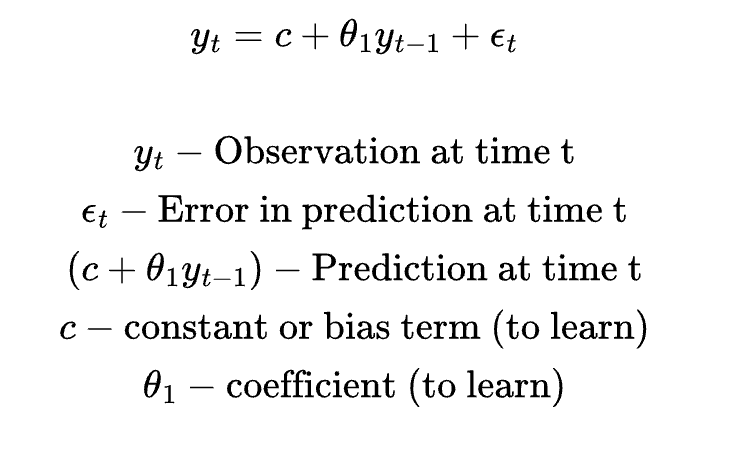
<br/><br/>
This indeed looks like a simple regression problem. The loss function and the update equation for the parameter(s) using gradient descent can be written simply as (similar update equation for the constant parameter):
<br/><br/>
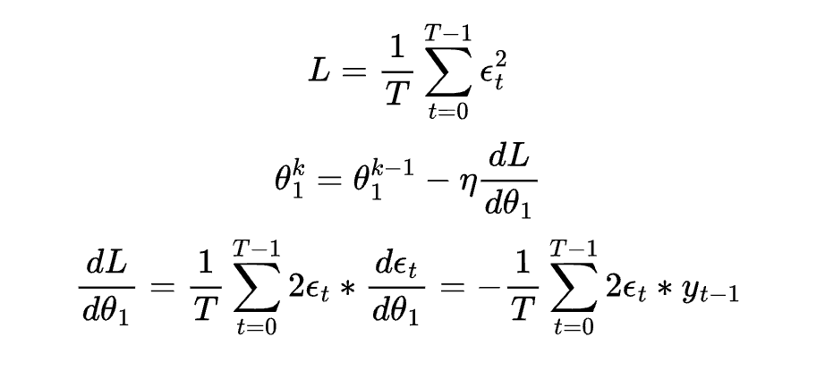
<br/><br/>
Adding more lag terms to the equation, uses more number of historical observations and the same update equation for each parameter, `theta` holds. Thus, we can see that with only lagged series, the equation is equivalent to a linear regression problem which we can either solve using matrix operations or iteratively using gradient descent as shown above. Apart from the lag terms, ARIMA also can have the moving average terms. The moving average terms are nothing but simply the error terms from the previous timesteps similar to the previous observations, and can be expressed as follows:
<br/><br/>
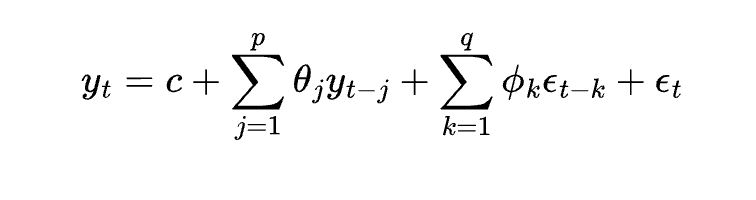
<br/><br/>
But note that, now the derivative of the loss L w.r.t. the parameters, `theta` and `phi` are not simple, because each moving average term (or the error terms) are also dependent on the  parameters and cannot be treated as constants unlike the past observation terms. The modified partial derivatives are as follows:
<br/><br/>
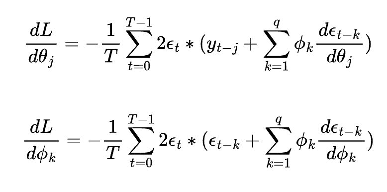
<br/><br/>
The above set of partial derivatives can be simplified by using recurrence relations `F` and `G` corresponding to the partial derivatives of the error at timestep t w.r.t. the parameters `theta` and `phi` respectively as follows:
<br/><br/>
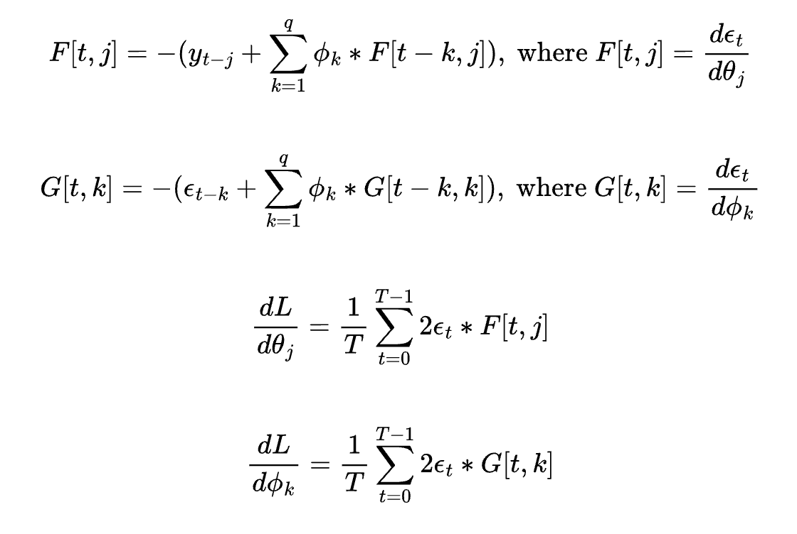
<br/><br/>
Either we explicitly compute the recurrence relations F and G and then the partial derivatives for gradient descent algorithm, or re-use the automatic differentiation implementation from the previous post. Using the automatic differentiation routine for scalars, we can very easily compute the loss as well as the updates to the parameters. But there was a gotcha in the prior implementation. In the ARIMA equation with moving average terms, each error term at timestep T is dependent recursively on the error terms from the last q timesteps. Thus a plain recursion implementation will have an exponential time complexity for automatic differentiation. Modified version shown below, caches all the node's forward and backward results for re-use.
<br/><br/>
```python
import numpy as np
import math

class node:
    def __init__(self):
        pass
    def forward(self, param_values):
        pass
    def backward(self):
        pass

class nn_context:
    param_nodes = {} # parameters node to id
    num_params = 0 # number of parameters
    fwd_cache = {}
    bwd_cache = {}

    @staticmethod
    def init():
        # init the settings
        nn_context.param_nodes = {}
        nn_context.num_params = 0
        nn_context.fwd_cache = {}
        nn_context.bwd_cache = {}

    @staticmethod
    def add_param_node(node:node):
        # add parameter node, increment id by 1
        nn_context.param_nodes[node] = nn_context.num_params
        nn_context.num_params += 1

    @staticmethod
    def get_param_node_id(node:node):
        # get node id for node
        return nn_context.param_nodes[node] if node in nn_context.param_nodes else None

    @staticmethod
    def get_num_params():
        # get number of parameters
        return nn_context.num_params

    @staticmethod
    def reset_cache():
        # reset fwd and bwd caches
        nn_context.fwd_cache = {}
        nn_context.bwd_cache = {}


class param_node(node):
    def __init__(self):
        nn_context.add_param_node(self)
        self.param_id = nn_context.get_param_node_id(self)

    def forward(self, param_vals):
        nn_context.fwd_cache[self] = param_vals[self.param_id] if self.param_id is not None else None
        return nn_context.fwd_cache[self]

    def backward(self):
        n = nn_context.get_num_params()
        out = np.zeros(shape=(1,n))
        out[0,self.param_id] = 1.0 # 1.0 only for self, 0.0 for all other parameters.
        nn_context.bwd_cache[self] = out
        return nn_context.bwd_cache[self]


class constant_node(node):
    def __init__(self, value):
        self.value = value

    def forward(self, param_vals):
        nn_context.fwd_cache[self] = self.value
        return nn_context.fwd_cache[self]

    def backward(self):
        n = nn_context.get_num_params() # all leaf nodes need to access nn_context
        nn_context.bwd_cache[self] = np.zeros(shape=(1,n))
        return nn_context.bwd_cache[self]


class sum_node(node):
    def __init__(self, u:node, v:node):
        self.u = u
        self.v = v

    def forward(self, param_values):
        if self not in nn_context.fwd_cache:
            u_f = self.u.forward(param_values)
            v_f = self.v.forward(param_values)
            nn_context.fwd_cache[self] = u_f + v_f

        return nn_context.fwd_cache[self]

    def backward(self):
        if self not in nn_context.bwd_cache:
            a:np.ndarray = self.u.backward()
            b:np.ndarray = self.v.backward()
            nn_context.bwd_cache[self] = np.array([[1.0, 1.0]]) @ np.concatenate((a, b), axis=0) # s = u_f + v_f, ds/du_f = 1 and ds/dv_f = 1

        return nn_context.bwd_cache[self]


class prod_node(node):
    def __init__(self, u:node, v:node):
        self.u = u
        self.v = v

    def forward(self, param_values):
        if self not in nn_context.fwd_cache:
            u_f = self.u.forward(param_values)
            v_f = self.v.forward(param_values)
            nn_context.fwd_cache[self] = u_f * v_f

        return nn_context.fwd_cache[self]

    def backward(self):
        if self not in nn_context.bwd_cache:
            u_f = nn_context.fwd_cache[self.u]
            v_f = nn_context.fwd_cache[self.v]

            a:np.ndarray = self.u.backward()
            b:np.ndarray = self.v.backward()

            nn_context.bwd_cache[self] = np.array([[v_f, u_f]]) @ np.concatenate((a, b), axis=0) # s = u_f * v_f, ds/du_f = v_f and ds/dv_f = u_f

        return nn_context.bwd_cache[self]
```
<br/><br/>
Using caching, the exponential complexity gets down to a quadratic time complexity algorithm.  To compute the loss function and the gradient updates, we need to write the routine to build the graph as follows:
<br/><br/>
```python
def get_predictions(inp, seq_len, p, q):
    # Get predictions for each time step
    p_params = [param_node() for _ in range(p)]
    q_params = [param_node() for _ in range(q)]
    bias = param_node()
    err_nodes = []
    pred_nodes = []

    for t in range(seq_len):
        pred = sum_node(constant_node(0.0), bias)

        for j in range(1, p+1):
            if t-j >= 0:
                g = prod_node(p_params[j-1], constant_node(inp[t-j]))
                pred = sum_node(pred, g)
            else:
                break

        for k in range(1, q+1):
            if t-k >= 0:
                h = prod_node(q_params[k-1], err_nodes[-k])
                pred = sum_node(pred, h)
            else:
                break

        pred_nodes += [pred]
        err = sum_node(constant_node(-inp[t]), pred)
        err_nodes += [err]

    return pred_nodes, err_nodes


nn_context.init()
pred_nodes, err_nodes = get_predictions(inp, seq_len, p, q)

# Compute the cost
cost = constant_node(0.0)
for err_node in err_nodes:
    cost = sum_node(cost, prod_node(constant_node(1.0/seq_len), prod_node(err_node, err_node)))
```
<br/><br/>
Let's generate a dummy time series of size 1000 and use lag=10 i.e. 10 past observations are used to predict current observation and number of moving average terms (q=3) and then run the training and predictions as follows:
<br/><br/>
```python
seq_len = 1000
p = 10
q = 3
learning_rate = 1e-3
num_epochs = 500

# generate time series data
steps = np.random.normal(loc=0, scale=10.0, size=seq_len)
random_walk = np.cumsum(steps)
inp = 1 / (1 + np.exp(-random_walk / 100))

# training for parameters.
p_val = np.random.normal(0.0, 1e-3, size=(p,))
q_val = np.random.normal(0.0, 1e-3, size=(q,))
b_val = np.array([0.0])

param_values = np.concatenate((p_val, q_val, b_val))

for epoch in range(500):
    nn_context.reset_cache()
    d = cost.forward(param_values)
    print(epoch, d)
    grads = cost.backward()[0]
    param_values -= learning_rate*grads

```
<br/><br/>
Our above approach to solve the ARIMA model with both lag and moving average term has a few drawbacks:
<br/><br/>
1. In the above training algorithm, if we set the initial values for `theta` and `phi` to be `N(0, 1)` instead of `N(0, 1e-3)`, most of the time, the loss goes to NaN. This is because the error term at timestep T is a function of the historical error terms weighted by the parameters `phi`. Based on the equations, `e(t)` is proportional to `phi(1)` time `e(t-1)`, `(phi(1))^2` times `e(t-2)` and so on. Thus if `|phi(1)|` is > 1, the error terms diverges across timesteps and thus the loss becomes infinite. Similarly analysis for the `theta` terms as well. In literature, these are the known as the `stationarity` and `invertibility` conditions of time series forecasting.

2. The moving average terms i.e. historical error terms `e(t-k)` are not observed directly unlike the historical observations `y(t-j)`. The gradient of the error `e(t)` w.r.t. the parameters i.e. `F(t,j)` and `G(t,j)` above, are dependent on all the previous gradients. Thus any error in the estimation of the error terms for the initial timesteps will propagate to all the later timesteps. For the initial timesteps, we do not have enough historical data to estimate the prediction and error terms correctly and thus it is highly likely that the later timesteps will also have incorrect estimations for the error terms.
<br/><br/>

In order to overcome the above problems, Kalman Filters are used to estimate the moving average terms per timestep. In the above approach, the past error terms `e(t-k)` are only estimated based on the previous observations but not updated based on the current observation, which causes the errors in estimation to propagate. In Kalman Filters, the moving average terms are the hidden state of the model and at each timestep T, the hidden state is estimated based on the previous state at T-1 as well as the true observation at T.
<br/><br/>
The Kalman Filter model at a high level looks like:
<br/><br/>
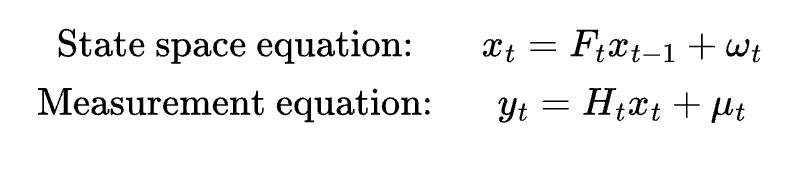
<br/><br/>
The state space model is used to predict the hidden state at time t based on the hidden state at time t-1. In the state space model, `F(t)` is the state transition matrix and `w(t)` is the additional noise term. The measurement equation models the observations `y(t)` as a function of the hidden states `x(t)`. `H(t)` is a projection matrix that projects hidden state to observed state. `u(t)` is the additional noise term in predicting observed state from hidden state. 
Note that the in both the state space model and the measurement equation, the noise terms are Gaussian with a mean of 0.
<br/><br/>
The hidden states are predicted using the following algorithm, step by step:
<br/><br/>
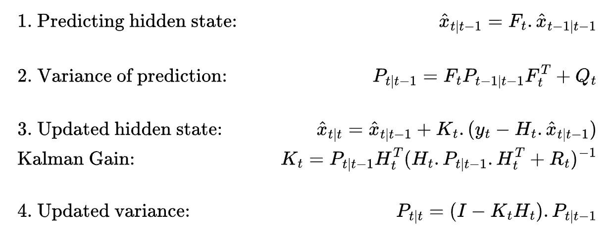
<br/><br/>
In the 1st step, we compute the predicted hidden state at timestep t using the updated hidden state at timestep t-1. Note that we use the words predicted and updated against hidden state estimations because the overall idea is that the hidden states are first predicted i.e. `x(t|t-1)` and then updated i.e. `x(t|t)` based on the observations `y(t)`. In the prediction step (step 1), the mean of the noise term `w(t)` is 0.
<br/><br/>
In the 2nd step, we estimate the co-variance of the predictions in step 1. The variance of `w(t)` is non-zero and hence the additional term `Q(t)` is there which is the variance of `w(t)`. `P(t|t-1)` is the covariance matrix of the predicted hidden states at time t. The variance of the prediction decides how much weight to give to the predictions vs how much weight to give to the observations when the hidden states are updated.
<br/><br/>
In the 3rd step, the hidden states are updated. It is the sum of the predicted hidden states and the error in predictions `y(t) - H(t)x(t|t-1)` weighted by the Kalman Gain K(t). Higher value of Kalman gain imply that the predictions are noisy and higher weightage is given to the observations. This facility is missing from our earlier model. 
<br/><br/>
The `R(t)` term in the Kalman gain equation is the variance of `u(t)` in the measurement equation above.
<br/><br/>
Finally, we also update the co-variance `P(t|t)` based on the observations.
<br/><br/>
Note, that in the above set of equations, we do not have explicit error terms that we can minimize using a loss function. In order to learn the optimum set of parameters (`F(t), Q(t), H(t), R(t)`) of the Kalman Filter, we maximize the log-likelihood of the observations. Without going through the derivations, here is the log-likelihood expression that we want to maximize.
<br/><br/>
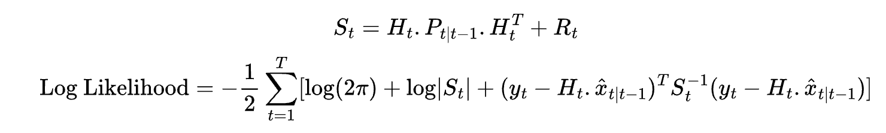
<br/><br/>
Next, we come to the part where we express our ARIMA equations above as a Kalman Filter model. Note that the Kalman filter equations only ties `x(t)` to `x(t-1)`. How do we express the lag terms and the moving average terms here? This is exactly what Harvey's representation solves for. It decomposes multi-lag and multi-MA ARIMA expressions into multi-dimension hidden state as follows. If the lag=p and number of MA terms are q, then the dimensionality of the hidden state is `n=max(p, q+1)` and the shape of the transition matrix F(t) is `nxn`. Below shows 2 examples with (p,q)=(5,2) and (p,q)=(2,3) as follows:
<br/><br/>
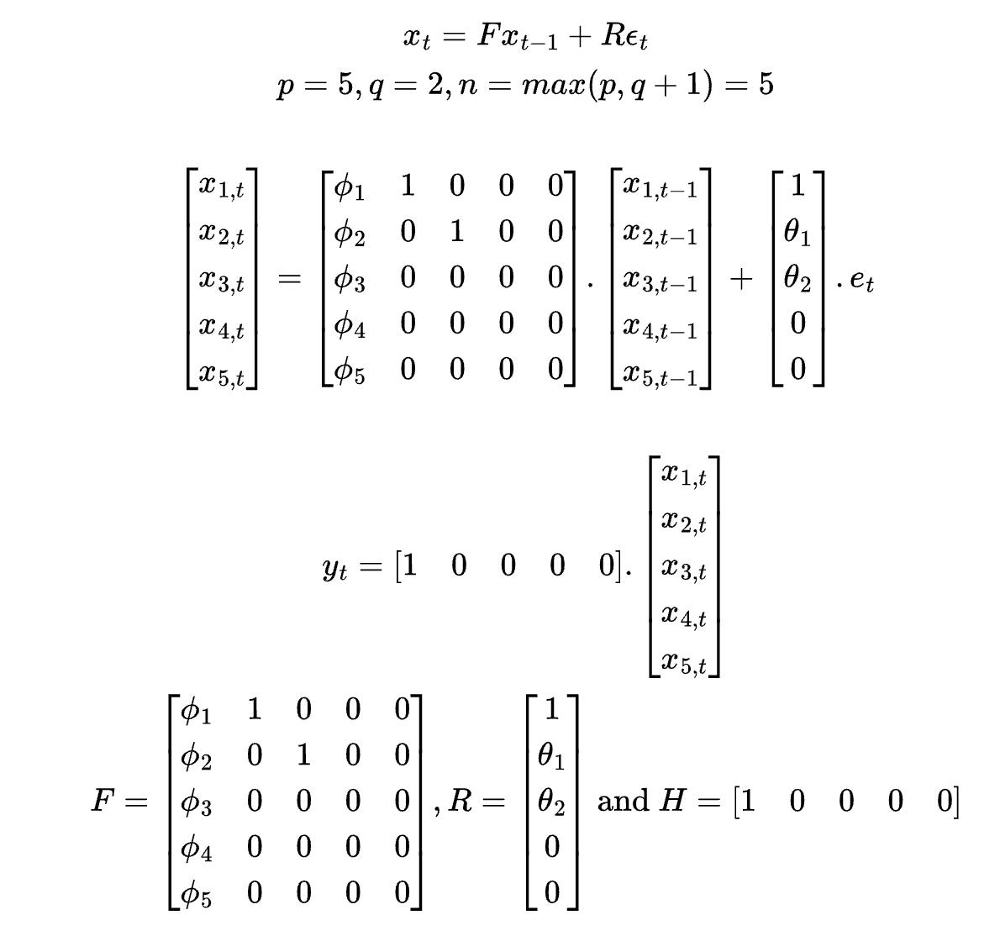
<br/><br/>
and
<br/><br/>
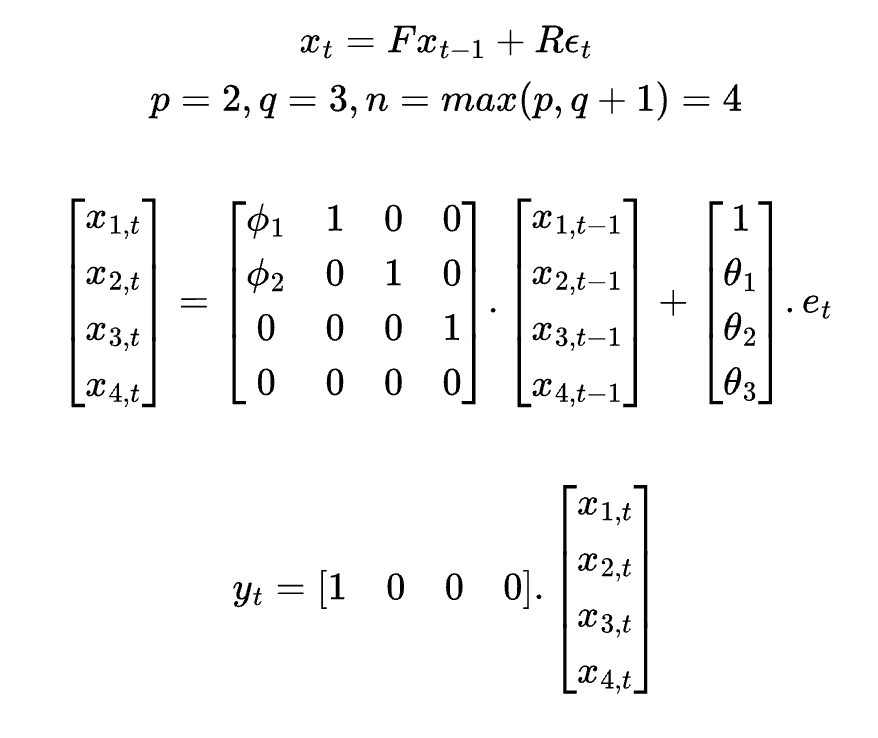
<br/><br/>
Expanding the matrix products and expanding the hidden state variables will give rise to the same ARIMA equation as in above:
<br/><br/>
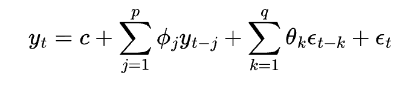
<br/><br/>
I noticed it later that the `phi` and `theta` notations are interchanged for the lag and the moving average terms as compared to the above approach, but it should not impact any calculation and analysis done in this post. The updated Kalman filter steps for the ARIMA equation above are as follows:
<br/><br/>
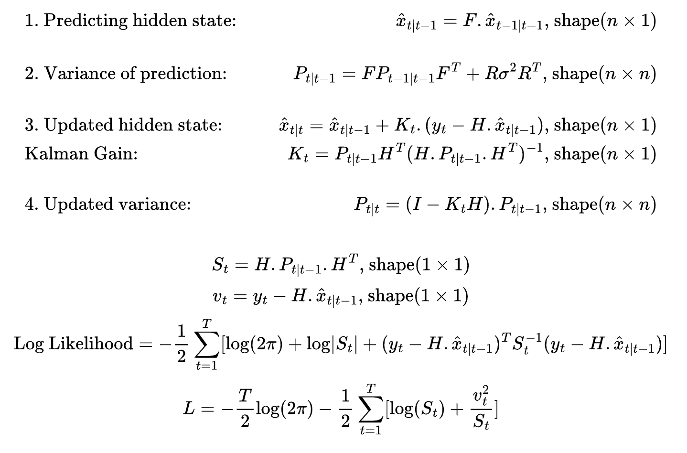
<br/><br/>
Coming to the implementation part, as before, we can express the above operations and the loss function as nodes in a graph. On top of the existing node classes as implemented above, we add a few more of the node classes corresponding to logarithm and division operations as follows:
<br/><br/>
```python
class div_node(node):
    def __init__(self, u:node, v:node):
        self.u = u
        self.v = v

    def forward(self, param_values):
        if self not in nn_context.fwd_cache:
            u_f = self.u.forward(param_values)
            v_f = self.v.forward(param_values)
            nn_context.fwd_cache[self] = u_f / v_f

        return nn_context.fwd_cache[self]

    def backward(self):
        if self not in nn_context.bwd_cache:
            u_f = nn_context.fwd_cache[self.u]
            v_f = nn_context.fwd_cache[self.v]

            a:np.ndarray = self.u.backward()
            b:np.ndarray = self.v.backward()
            nn_context.bwd_cache[self] = np.array([[1.0/v_f, -u_f/(v_f**2)]]) @ np.concatenate((a, b), axis=0)

        return nn_context.bwd_cache[self]


class log_node(node):
    def __init__(self, u:node):
        self.u = u

    def forward(self, param_values):
        if self not in nn_context.fwd_cache:
            u_f = self.u.forward(param_values)
            nn_context.fwd_cache[self] = math.log(u_f)

        return nn_context.fwd_cache[self]

    def backward(self):
        if self not in nn_context.bwd_cache:
            u_f = nn_context.fwd_cache[self.u]

            a:np.ndarray = self.u.backward()
            nn_context.bwd_cache[self] = np.array([[1.0/u_f]]) @ a

        return nn_context.bwd_cache[self]
```
<br/><br/>
Then we define the operations corresponding to predicting and updating the hidden states and predicting and updating the prediction variances along with minimizing the negative log likelihood objective.
<br/><br/>
```python
def pred_hidden(f, prev_xu_node):
    # Predict the hidden state x(t|t-1) from previous updated state x(t-1|t-1)
    n, m, p = len(f), len(f[0]), len(prev_xu_node[0])
    xp_node = [[None] for _ in range(n)]

    # Dot product of nodes F and x(t-1|t-1): F.x(t|t-1)
    for i in range(n):
        for j in range(p):
            s = constant_node(0.0)
            for k in range(m):
                s = sum_node(s, prod_node(f[i][k], prev_xu_node[k][j]))
            xp_node[i][j] = s

    return xp_node


def pred_var(f, r, v, prev_pu_node):
    # Compute the variance of prediction of hidden state x(t|t-1) as P(t|t-1) from previous updated variance P(t-1|t-1)
    n, m, p = len(f), len(f[0]), len(prev_pu_node[0])
    g = [[None for _ in range(p)] for _ in range(n)]

    # Dot product G=F.P(t-1|t-1)
    for i in range(n):
        for j in range(p):
            s = constant_node(0.0)
            for k in range(m):
                s = sum_node(s, prod_node(f[i][k], prev_pu_node[k][j]))
            g[i][j] = s

    n, m, p = len(g), len(g[0]), len(f)
    pp_node = [[None for _ in range(p)] for _ in range(n)]

    # Dot product G.F^T
    for i in range(n):
        for j in range(p):
            s = constant_node(0.0)
            for k in range(m):
                s = sum_node(s, prod_node(g[i][k], f[j][k]))
            pp_node[i][j] = s

    n, p = len(pp_node), len(pp_node[0])

    # Computes P(t|t-1) = F.P(t-1|t-1).F^T + v^2 * RR^T
    for i in range(n):
        for j in range(p):
            pp_node[i][j] = sum_node(pp_node[i][j], prod_node(prod_node(v[0][0], v[0][0]), prod_node(r[i][0], r[j][0])))

    return pp_node


def get_innovation_error(y, h, xp_node):
    # Compute the innovation error terms v(t) = y(t) - H.x(t|t-1)
    n, m, p = len(h), len(h[0]), len(xp_node[0])
    err_node = [[None for _ in range(p)] for _ in range(n)]

    # Dot product H.x(t|t-1)
    for i in range(n):
        for j in range(p):
            s = constant_node(0.0)
            for k in range(m):
                s = sum_node(s, prod_node(h[i][k], xp_node[k][j]))
            err_node[i][j] = sub_node(constant_node(y), s)

    return err_node


def get_innovation_var(h, pp_node):
    # Compute the innovation variance S(t) = H.P(t|t-1).H^T
    n, m, p = len(h), len(h[0]), len(pp_node[0])
    g = [[None for _ in range(p)] for _ in range(n)]

    # Dot product G=H.P(t|t-1)
    for i in range(n):
        for j in range(p):
            s = constant_node(0.0)
            for k in range(m):
                s = sum_node(s, prod_node(h[i][k], pp_node[k][j]))
            g[i][j] = s

    n, m, p = len(g), len(g[0]), len(h)
    var_obsv = [[None for _ in range(p)] for _ in range(n)]

    # Dot product G.H^T
    for i in range(n):
        for j in range(p):
            s = constant_node(0.0)
            for k in range(m):
                s = sum_node(s, prod_node(g[i][k], h[j][k]))
            var_obsv[i][j] = s

    return var_obsv


def get_kalman_gain(h, pp_node, var_obsv):
    # Compute Kalman Gain K(t) = P(t|t-1).H^T/S(t)
    n, m, p = len(pp_node), len(pp_node[0]), len(h)
    kalman_gain = [[None for _ in range(p)] for _ in range(n)]

    # Dot product P(t|t-1).H^T
    for i in range(n):
        for j in range(p):
            s = constant_node(0.0)
            for k in range(m):
                s = sum_node(s, prod_node(pp_node[i][k], h[j][k]))
            kalman_gain[i][j] = div_node(s, var_obsv[0][0])

    return kalman_gain


def update_hidden(kalman_gain, err_node, xp_node):
    # Update the hidden state predictions x(t|t) = x(t|t-1) + K(t).v(t)
    n, m, p = len(kalman_gain), len(kalman_gain[0]), len(err_node[0])
    xu_node = [[None for _ in range(p)] for _ in range(n)]

    for i in range(n):
        for j in range(p):
            s = constant_node(0.0)
            for k in range(m):
                s = sum_node(s, prod_node(kalman_gain[i][k], err_node[k][j]))
            xu_node[i][j] = sum_node(xp_node[i][j], s)

    return xu_node


def update_var(kalman_gain, pp_node, h):
    # Update the hidden state variance P(t|t) = (I - K(t).H).P(t|t-1)
    n, m, p = len(kalman_gain), len(kalman_gain[0]), len(h[0])
    g = [[constant_node(0.0) for _ in range(p)] for _ in range(n)]

    for i in range(n):
        g[i][i].value = 1.0

    for i in range(n):
        for j in range(p):
            s = constant_node(0.0)
            for k in range(m):
                s = sum_node(s, prod_node(kalman_gain[i][k], h[k][j]))
            g[i][j] = sub_node(g[i][j], s)

    n, m, p = len(g), len(g[0]), len(pp_node[0])
    pu_node = [[None for _ in range(p)] for _ in range(n)]

    for i in range(n):
        for j in range(p):
            s = constant_node(0.0)
            for k in range(m):
                s = sum_node(s, prod_node(g[i][k], pp_node[k][j]))
            pu_node[i][j] = s

    return pu_node


def get_likelihood(inp, pu_init, f, r, v, h, seq_len, n):
    # Compute negative log likelihood
    s = constant_node(0.5*seq_len*np.log(2*np.pi))

    # Set the initial values of hidden state and variance x(0|0) and P(0|0)
    prev_xu_node = [[constant_node(0.0)] for _ in range(n)]
    prev_pu_node = [[constant_node(pu_init[i,j]) for j in range(n)] for i in range(n)]

    for t in range(seq_len):
        # get hidden state predictions
        xp_node = pred_hidden(f, prev_xu_node)

        # get hidden state variance
        pp_node = pred_var(f, r, v, prev_pu_node)

        # get innovation errors
        err_node = get_innovation_error(inp[t], h, xp_node)

        # get innovation error variance
        var_obsv = get_innovation_var(h, pp_node)

        # get kalman gain
        kalman_gain = get_kalman_gain(h, pp_node, var_obsv)

        # compute negative log likelihood
        s = sum_node(
                s,
                prod_node(
                    constant_node(0.5),
                    sum_node(
                        log_node(var_obsv[0][0]),
                        div_node(
                            prod_node(
                                err_node[0][0],
                                err_node[0][0]
                            ),
                            var_obsv[0][0]
                        )
                    )
                )
            )

        # update hidden state
        prev_xu_node = update_hidden(kalman_gain, err_node, xp_node)

        # update hidden state variance
        prev_pu_node = update_var(kalman_gain, pp_node, h)

    return s
```
<br/><br/>
Once we have the functions to generate the graphs for the operations and negative log likelihood calculations, we can go ahead and run the forward and backward passes across multiple epochs to train the negative log likelihood model using the Kalman Filter. Similar to before we generate a dummy time series data as follows (we are using lag=3 and MA terms q=2):
<br/><br/>
```python
seq_len = 100
p = 3
q = 2
n = max(p, q+1)

# Generate random time series data of length seq_len.
steps = np.random.normal(loc=0, scale=0.5, size=seq_len)
random_walk = np.cumsum(steps)
inp = 1 / (1 + np.exp(-random_walk / 3))
```
<br/><br/>
Next we init the context graph and setup the parameters which we want to learn from the model. In our ARIMA model, we want to learn the lag parameters `phi` and the moving average parameters `theta`. Apart from these, we also want to learn the variance of the error terms. The transition matrix `F` contains the lag parameters in its 1st column and the column matrix `R` contains the MA parameters. Thus, we initialise `F` and `R` as parameters along with `v` which is the variance of the error terms. The matrix `H` is a row vector with 1 as its 1st entry and remaining zeros:
<br/><br/>
```python
nn_context.init()

f = [[param_node() for _ in range(n)] for _ in range(n)]
r = [[param_node()] for _ in range(n)]
v = [[param_node()]]

h = [[constant_node(0.0) for _ in range(n)]]
h[0][0].value = 1.0
```
<br/><br/>
Note that, in `f` above, we declare all the elements of the `nxn` matrix as a `param_node()` but in reality only the 1st column contains the lag parameters, all other entries are either 0 or 1. This is handled within the training code, where the gradient updates are only applied to the actual `phi` entries. Remaining entries are not updated. Same for the `r` matrix. We initialise the `phi` and `theta` values from a normal `N(0, 1e-3)` distribution as follows:
<br/><br/>
```python
phi = np.random.normal(0.0, 1e-3, size=(p,))
theta = np.random.normal(0.0, 1e-3, size=(q,))

# Initialise F matrix 
f_ini = np.zeros(shape=(n,n), dtype=np.float32)

for i in range(p):
    # only these entries are updated.
    f_ini[i,0] = phi[i]

for i in range(q):
    f_ini[i,i+1] = 1.0

# Initialise R matrix 
r_ini = np.zeros(shape=(n,1), dtype=np.float32)
r_ini[0,0] = 1.0

for i in range(1, q+1):
    # only these entries are updated.
    r_ini[i,0] = theta[i-1]

# Variance of error terms e(t) ~ N(0, v**2)
v_ini = np.array([[1.0]])

f_ini = f_ini.flatten()
r_ini = r_ini.flatten()
v_ini = v_ini.flatten()
```
<br/><br/>
The training module that runs the forward and backward pass for multiple epochs and updates the parameters using gradient descent:
<br/><br/>
```python
n_epochs = 100
learning_rate = 1e-4

# Initialise the co-variance matrix P(0|0)
pu_init = np.random.normal(0.0, 1e-3, size=(n,n))

# Get the cost node in the graph.
cost = get_likelihood(inp, pu_init, f, r, v, h, seq_len, n)
param_values = np.concatenate((f_ini, r_ini, v_ini))

# Indices to update during gradient descent
indices = [i*n for i in range(p)] + [n*n + i for i in range(1, q+1)] + [n*n + n]

for epoch in range(n_epochs):
    nn_context.reset_cache()
    loss = cost.forward(param_values)
    print(epoch, loss)

    grads = cost.backward()[0]
    param_values[indices] -= learning_rate*grads[indices]
```
<br/><br/>
Once you run the above training module, you will observe that the loss either explodes to `NaN` or stays constant throughout. This is because, if the innovation covariance term `S(t)=H.P(t|t-1).H^T` becomes arbitrarily large, the loss becomes large. Also, the gradients w.r.t. parameters have S(t) in the denominator which implies that any updates to the parameters `phi` and `theta` will be infinitesimal if `S(t)` is very large, thus model won't learn anything. 
<br/><br/>
The innovation covariance term S(t) is dependent on the prediction covariance `P(t|t-1)` and if this term diverges across timesteps, then `S(t)` also diverges so do the loss. To correct this behaviour, the initial values of the prediction covariance matrix `P(0|0)` is chosen in such a way so as to make the series stationary i.e.
<br/><br/>
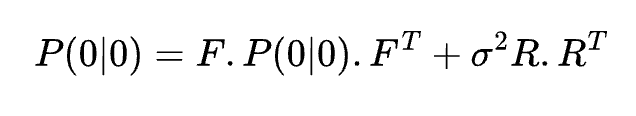
<br/><br/>
The above equation is known as the `Lyapunov equation` and is solved using the below strategy. The `vec` operator is the vectorization operator that flattens a N-D tensor/vector into a 1-D tensor/vector and using the vectorization property that `vec(AXB)=(B^T kron_prod A).vec(X)` we transform the above equation into a linear solver for solving with `np.linalg`:
<br/><br/>
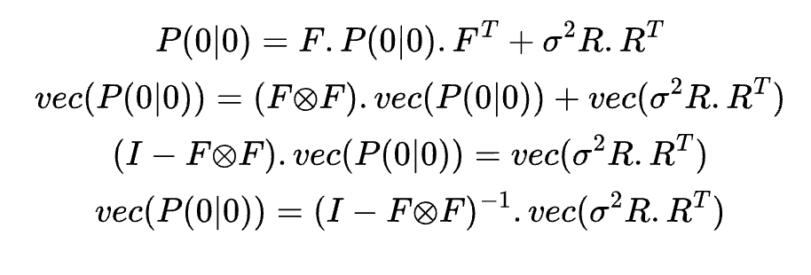
<br/><br/>
In Python:
<br/><br/>
```python
def init_pu(f:np.ndarray, r:np.ndarray, v:np.ndarray, n:int):
    """
    Computes P_0|0 using Kronecker products.
    """

    V = v[0][0]**2 * (r @ r.T)

    I_n2 = np.eye(n * n)
    f_kron_f = np.kron(f, f)

    vec_V = V.flatten()
    vec_P = np.linalg.solve(I_n2 - f_kron_f, vec_V)

    P_0 = vec_P.reshape(n, n)
    return P_0

```
<br/><br/>
Apart from the above change, changing gradient descent to `Adam` optimizer helps stabilize the learning. Using gradient descent, the loss starts to diverge after some epochs indicating that the learning rate is too high at that point. Adam optimizer implementation in Python (the algorithm is pretty simple and can be implemented in just a few lines of python):
<br/><br/>
```python
class AdamOptim:
    def __init__(self, num_params, learning_rate=0.001):
        self.num_params = num_params
        self.m = [0.0]*num_params
        self.v = [0.0]*num_params
        self.beta_1 = 0.9
        self.beta_2 = 0.999
        self.epsilon = 1e-8
        self.iter = 1
        self.alpha = learning_rate

    def optimize(self, curr_values, indices, gradients):
        # indices indicates which all parameters we want to update and which to mask.
        for i in indices:
            self.m[i] = self.beta_1*self.m[i] + (1-self.beta_1)*gradients[i]
            self.v[i] = self.beta_2*self.v[i] + (1-self.beta_2)*gradients[i]*gradients[i]

            m_alt = self.m[i]/(1-self.beta_1**self.iter)
            v_alt = self.v[i]/(1-self.beta_2**self.iter)

            curr_values[i] -= (self.alpha*m_alt)/(np.sqrt(v_alt) + self.epsilon)

        self.iter += 1
        return curr_values
```
<br/><br/>
The updated training loop using Adam optimizer and solving Lyapunov equation to estimate `P(0|0)`:
<br/><br/>
```python
n_epochs = 500
# Adam optimizer
optim = AdamOptim(nn_context.num_params, learning_rate=1e-3)

# P(0|0) solve using Lyapunov equation
pu_init = init_pu(f_ini, r_ini, v_ini, n)

cost, pred_nodes = get_likelihood(inp, pu_init, f, r, v, h, seq_len, n)
param_values = np.concatenate((f_ini, r_ini, v_ini))

indices = [i*n for i in range(p)] + [n*n + i for i in range(1, q+1)] + [n*n + n]

for epoch in range(n_epochs):
    nn_context.reset_cache()
    res = cost.forward(param_values)
    print(epoch, res)

    grads = cost.backward()[0]
    param_values = optim.optimize(param_values, indices, grads)
```
<br/><br/>
Comparing the MSE between the actual and the predicted time series using the earlier method of MSE Loss vs. Kalman Filter, we see approximately `10-100x` improvement in MSE score using Kalman Filter approach. The below plot shows the predicted time series using MSE Loss vs. Kalman Filter + Negative Log Likelihood. The orange line is the actual time series and the green line are the Kalman Filter predictions whereas the blue line are the predictions with the MSE Loss approach. Clearly, we can see that the green line follows the orange line closely.
<br/><br/>
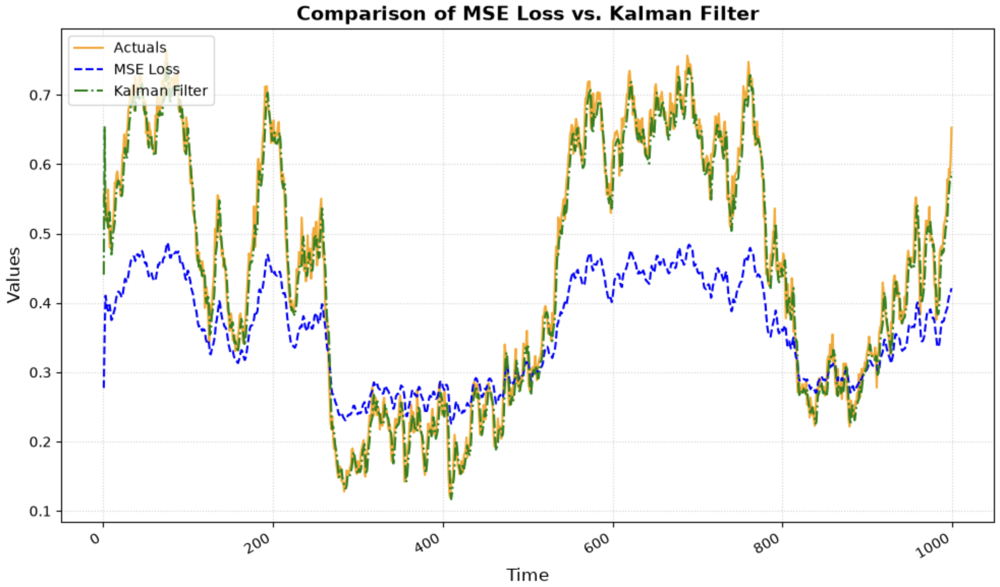
<br/><br/>
We conclude this post here but note that we have not yet explored the engineering required to deal with differencing (both seasonal and non-seasonal) and seasonal lags and seasonal MA terms. Adding those will make the ARIMA equations more complicated but they would not change much how the parameters are solved. Also, the same approach can be extended further to include covariates as additional features. We leave those as an exercise for the reader.
