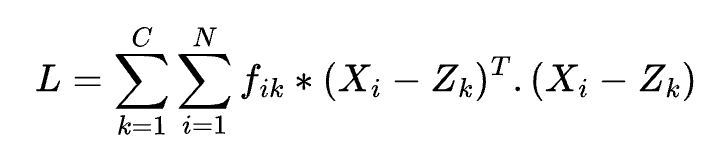
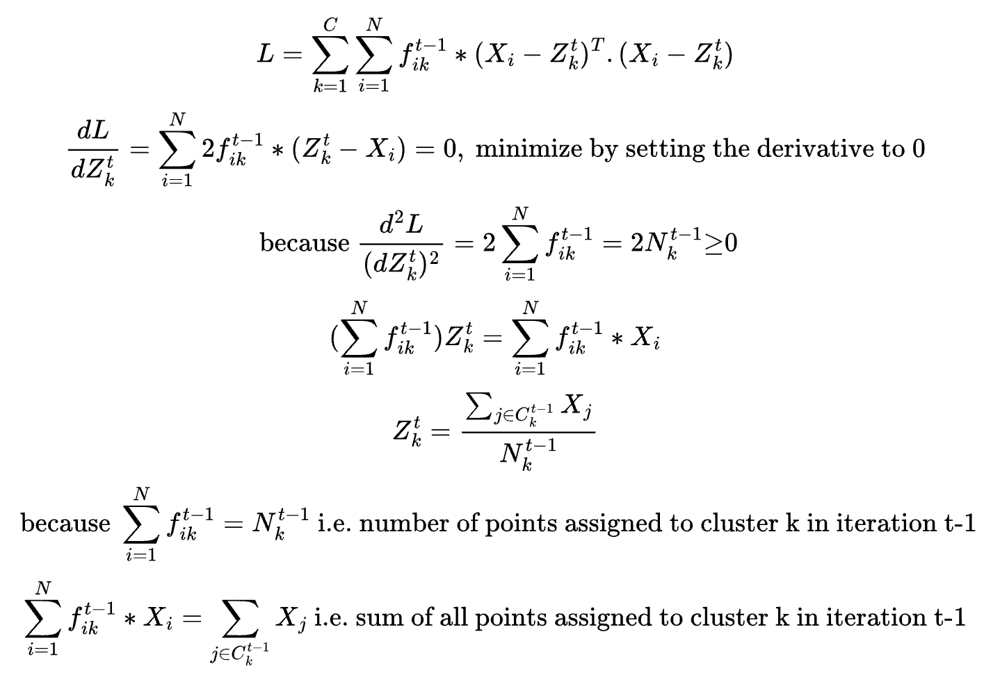
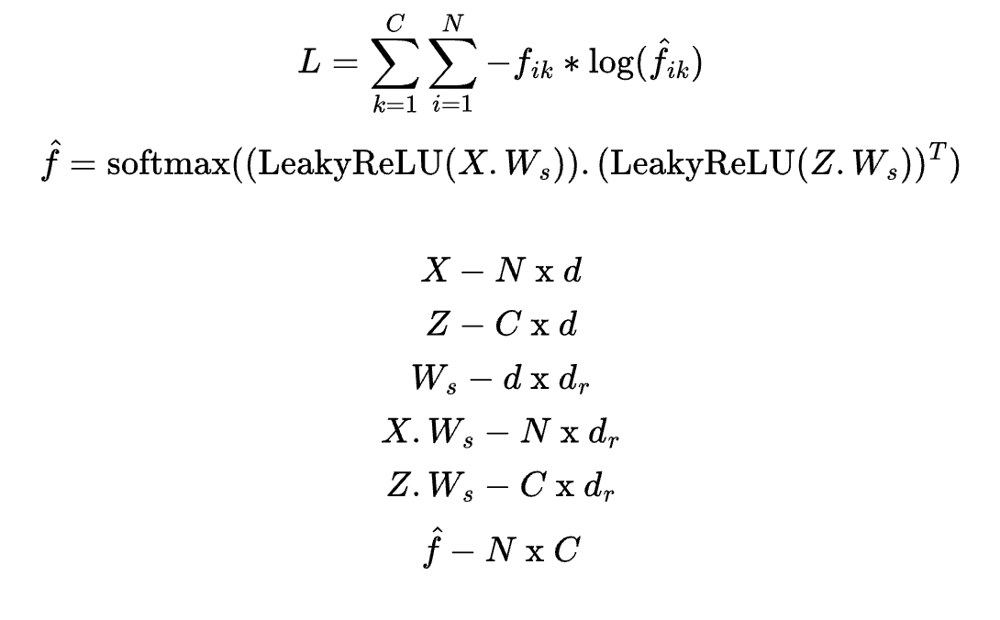

K-Means is probably one of the first standard ML algorithm that an ML engineer learns to implement from scratch. Although K-Means is a very simple and straightforward algorithm to implement but it has a wide range of applicability across different ML related domains such as customer segmentation and churn prediction in marketing, image segmentation in computer vision, grouping similar users and products in recommendation systems and so on. Discounting the scaling challenges associated with hundreds of billions of data points, a good enough implementation can be done to cluster millions of points pretty accurately on a single PC. The simplicity of the algorithm lies in the loss function.
<br/><br/>

<br/><br/>
In the above loss function to minimize, each `X(i)` is a `nx1` vector and `Z(k)` is also `nx1` vector. `k` denotes the cluster index and `Z(k)` is the centroid corresponding to cluster `k`. `X(i)` are the data points. `f(ik)` is 1 is point `i` belongs to cluster `k` else 0. Thus, we minimize the distances of each point to its 'assigned' cluster or in other words, assign the points to clusters so that the total sum of distances of each point to its assigned cluster centroid is minimized. Note that we have not yet established that 'assigned' means the 'nearest' cluster.
<br/><br/>
Note that the optimization steps involved to minimize the above loss is an EM-algorithm (Expectation-Maximization) because to assign points to one of the clusters, I need to know the cluster centroids, but the cluster centroids are not known beforehand and also has to be estimated. In problems such as this, involving chicken-and-egg relation, EM algorithm is a suitable approach. The idea is to first assume some cluster centroids, find the best assignment and then re-estimate the cluster centroids in the next iteration and so on.
<br/><br/>
```
1. Assume random cluster centroids.
2. Solve for the above assignment problem by minimizing the loss.
3. Re-estimate cluster centroids based on 2.
4. Repeat steps 2 & 3 iteratively until the above loss has not moved by some epsilon.
```
<br/><br/>
In step 2 above, solving for the assignment problem is pretty straightforward because the loss terms are `(X(i)-Z(k))**2` which is the distance of `X(i)` from `Z(k)`. Thus, solving step 2 implies finding the nearest cluster centroid for each point. Another way to look at it is to think of a cost matrix `C[i,k]` with entries equal to `(X(i)-Z(k))**2`. Then from each row take exactly one column such that the total sum of values is minimum. Without any constraints, this is a classic greedy algorithm problem which is solved by taking the column with the minimum cost from each row.
<br/><br/>
For step 3, once we know the cluster assignments based on step 2 i.e. we now know the values of `f[i,k]`, we can then solve the optimization problem for the unknowns `Z(k)` i.e. cluster centroids. Fortunately, we have a convex optimization problem in our hand with a global minima as follows:
<br/><br/>

<br/><br/>
Thus, it is proven that the updated values for the cluster centroids in iteration `t` is nothing but the average of all the points assigned to that cluster centroid in the previous iteration. Discounting the fact that the initial random selection of cluster centroids is sub-optimal and the convergence can be made faster by using a different algorithm (`K-Means++`) and the challenges in choosing the optimal number of clusters (usually through `AIC` or `BIC` scores), this is all there is to `K-Means`.
<br/><br/>
Note that the training did not go through the usual gradient descent or other such optimization routines as we saw in our earlier posts. This is because we could analytically solve for `Z(k)` by setting the derivative of the loss w.r.t. `Z(k)` to 0. Now, what if we can't do that. In the below scheme, we changed the loss function. Instead of an `euclidean distance` measure as the loss function, we chose to transform this into a `multi-class classification` problem. Using some random `Z`, we predict the probabilities `f[i,k]` i.e. point i belonging to cluster k using a deep neural network + softmax operation, then move the continuous values for the probabilties to the actual 0/1 values using the categorical-cross-entropy loss function and simultaneously update `Z` as follows.
<br/><br/>

<br/><br/>
In the above scheme, we use the DNN weights `W(s)` (shared weights between X and Z) to project the d-dimensional vectors `X` and `Z` to a reduced `d_r` dimension and then take a softmax over the dot product of the reduced `X` and reduced `Z`. Note that the DNN model needs to be re-trained for every iteration of the EM algorithm because the DNN is only used to estimate the cluster centroids Z. The assignments are done in the 
