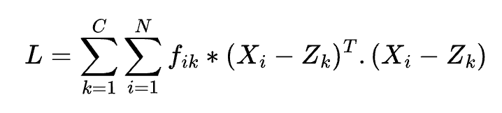
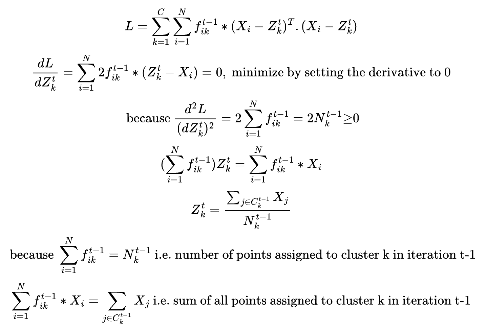

K-Means is probably one of the first standard ML algorithm that an ML engineer learns to implement from scratch. Although K-Means is a very simple and straightforward algorithm to implement but it has a wide range of applicability across different ML related domains such as customer segmentation and churn prediction in marketing, image segmentation in computer vision, grouping similar users and products in recommendation systems and so on. 
<br/><br/>
Ignoring the scaling challenges associated with hundreds of billions of data points, a good enough implementation can be done to cluster millions of points pretty accurately on a single PC. The simplicity of the algorithm lies in its loss function.
<br/><br/>

<br/><br/>
In the above loss function to minimize, each `X(i)` is a `nx1` vector and `Z(k)` is also `nx1` vector. `k` denotes the cluster index and `Z(k)` is the centroid corresponding to cluster `k`. `X(i)` are the data points. `f(i,k)=1` if point `i` belongs to cluster `k` else `f(i,k)=0`. Thus, we minimize the distances of each point to its 'assigned' cluster or in other words, assign the points to clusters so that the total sum of distances of each point to its assigned cluster centroid is minimized. 
<br/><br/>
Note that we have not yet established that 'assigned' means the 'nearest' cluster.
<br/><br/>
Note that the optimization steps involved to minimize the above loss is an `EM-algorithm` (Expectation-Maximization) because to assign points to one of the clusters, I need to know the cluster centroids, but the cluster centroids are not known beforehand and also has to be estimated. In problems such as this, involving chicken-and-egg relation, EM algorithm is a suitable approach provided it goes to convergence. 
<br/><br/>
The idea is to first assume some cluster centroids, find the best assignment and then re-estimate the cluster centroids in the next iteration and so on.
<br/><br/>
```
1. Assume random cluster centroids.
2. Solve for the above assignment problem by minimizing the loss.
3. Re-estimate cluster centroids based on 2.
4. Repeat steps 2 & 3 iteratively until the above loss has not moved by some epsilon.
```
<br/><br/>
In step 2 above, solving for the assignment problem is pretty straightforward because the loss terms are `(X(i)-Z(k))**2` which is the distance of `X(i)` from `Z(k)`. Thus, solving step 2 implies finding the nearest cluster centroid for each point. Another way to look at it is to think of a cost matrix `C[i,k]` with entries equal to `(X(i)-Z(k))**2`. Then from each row take exactly one column such that the total sum of values is minimum. 
<br/><br/>
Without any constraints, this is a classic greedy algorithm problem which is solved by taking the column with the minimum cost from each row.
<br/><br/>
For step 3, once we know the cluster assignments based on step 2 i.e. we now know the values of `f[i,k]`, we can then solve the optimization problem for the unknowns `Z(k)` i.e. cluster centroids. Fortunately, we have a convex optimization problem in our hand with a global minima as follows:
<br/><br/>

<br/><br/>
Thus, it is proven that the updated values for the cluster centroids in iteration `t` is nothing but the average of all the points assigned to that cluster centroid in the previous iteration. Here is a simple Python implementation using vectorised NumPy operations:
<br/><br/>
```python
import numpy as np

def get_initial_centroids(inp:np.ndarray, k:int):
    """
    Get initial centroids.
    """
    rng = np.random.default_rng()
    z = rng.choice(inp, size=k, replace=False, axis=0)
    return z
 
def kmeans(inp:np.ndarray, k:int, num_iters:int):
    """
    Returns cluster centroids and assignments.
    """
    z = get_initial_centroids(inp, k)
    f = None

    for iter in range(num_iters):
        # sum[i,j] (inp[i]-z[j])^T.(inp[i]-z[j])
        a = np.sum(inp**2, axis=1, keepdims=True)
        b = np.sum(z**2, axis=1, keepdims=True)
        c = inp @ z.T

        # d[i,j] - distance of point i from centroid j.
        d = a + b - 2*c

        # loss is the sum of the minimum distances for each point.
        loss = np.min(d, axis=1).sum()
        print(f"Loss at epoch={iter} : {loss}")

        # f is 1 for centroid with minimum distance from point else 0
        f = (d == d.min(axis=1, keepdims=True)).astype(int)

        # g gives the number of points assigned to each centroid
        g = np.sum(f, axis=0, keepdims=True)

        # centroids are the mean of the points assigned to cluster.
        # g.T + 1e-10 small constant added to avoid division by 0.
        z = (f.T @ inp)/(g.T + 1e-10)

    return z, f
```
<br/><br/>
The initial centroids are selected randomly from the existing points but it may not be an optimal approach as the chosen points may all belong to the same cluster. `K-Means++` is a preferred algorithm for selection of initial centroids. The algorithm iteratively selects the centroids such that the next point to select is sampled from points which are far away from existing centroids. A simple Python implementation for K-Means++.
<br/><br/>
```python
import numpy as np
import random

def get_initial_centroids(inp:np.ndarray, k:int):
    """
    Get initial centroids using K-Means++
    """
    centroid_indices = []

    # select 1st point randomly
    centroid_indices += [random.randint(0, inp.shape[0]-1)]

    while len(centroid_indices) < k:
        # select next centroids from remaining points
        non_centroid_indices = list(set(list(range(inp.shape[0])))-set(centroid_indices))
        centroids = inp[centroid_indices,:]

        # find the minimum distances of each point to any cluster.
        inp_h = inp[non_centroid_indices,:]
        a = np.sum(inp_h**2, axis=1, keepdims=True)
        b = np.sum(centroids**2, axis=1, keepdims=True)
        c = inp_h @ centroids.T
        d = a + b - 2*c

        min_distances = np.min(d, axis=1).reshape((d.shape[0],))
        sum_min_distances = np.sum(min_distances)
        min_distances = min_distances/sum_min_distances
        dc = np.cumsum(min_distances)

        # sample uniformly from the distribution of the distances. Higher distances has higher probabilities of getting sampled.
        u = random.uniform(0.0, 1.0)
        l,r = 0, dc.shape[0]-1
        p = -1
        while l <= r:
            m = int((l+r)/2)
            if u <= dc[m]:
                p = m
                r = m-1
            else:
                l = m+1

        if p == -1:
            break

        centroid_indices += [non_centroid_indices[p]]

    return inp[centroid_indices,:]
```
<br/><br/>
Note that the training did not go through the usual gradient descent or other such optimization routines as we saw in our earlier posts. This is because we could analytically solve for `Z(k)` by setting the derivative of the loss w.r.t. `Z(k)` to 0. Complicating the problem and the loss function a bit here. The next problem deals with `Deep Clustering Networks`. The idea is to learn reduced dimension representations for the input vectors that would be optimized for the clustering problem i.e. learn the embeddings such that the points in the reduced dimension are better clustered around their centroids.
<br/><br/>
If we learn the embeddings separately, it may happen that the points in reduced dimension are "scattered everywhere". But learning the embeddings and the clusters jointly avoids this problem. A lot of problems require reducing the dimensionality of data e.g. high dimensional data (lots of features), sparse vectors etc. Learning the reduced representation through `PCA` or `SVD` does not optimize the downstream problem of clustering or classification or regression. Using our autograd framework written in earlier posts for tensors.
<br/><br/>
```python
class uDotvNode(Node):
    def __init__(self, u:Node, v:Node):
        self.u = u
        self.v = v

    def forward(self, param_vals:np.ndarray):
        if self not in NNContext.fwd_cache:
            u_f = self.u.forward(param_vals)
            v_f = self.v.forward(param_vals)
            NNContext.fwd_cache[self] = np.dot(u_f, v_f)

        return NNContext.fwd_cache[self]

    def backward(self):
        if self not in NNContext.bwd_cache:
            u_f = NNContext.fwd_cache[self.u]
            v_f = NNContext.fwd_cache[self.v]

            n_u = get_total_shape(u_f.shape)
            m_u = u_f.shape[-1]
            p_u = int(n_u/m_u)

            v_ft = np.swapaxes(v_f, -2, -1)
            n_v = get_total_shape(v_ft.shape)
            m_v = v_ft.shape[-1]
            p_v = int(n_v/m_v)

            a = np.kron(np.eye(p_u, p_u, dtype=np.float32), v_ft)
            b = np.kron(u_f, np.eye(p_v, p_v, dtype=np.float32))

            arr = [[a, b]]

            u_b = self.u.backward()
            v_b = self.v.backward()

            out = u_b + v_b
            NNContext.bwd_cache[self] = tensor_prod(arr, out)

        return NNContext.bwd_cache[self]


class SumNode(Node):
    def __init__(self, u:Node, v:Node):
        self.u = u
        self.v = v

    def forward(self, param_vals:np.ndarray):
        if self not in NNContext.fwd_cache:
            u_f = self.u.forward(param_vals)
            v_f = self.v.forward(param_vals)
            NNContext.fwd_cache[self] = u_f + v_f

        return NNContext.fwd_cache[self]

    def backward(self):
        if self not in NNContext.bwd_cache:
            w_f:np.ndarray = NNContext.fwd_cache[self]
            u_f:np.ndarray = NNContext.fwd_cache[self.u]
            v_f:np.ndarray = NNContext.fwd_cache[self.v]

            n = get_total_shape(w_f.shape)
            m = get_total_shape(u_f.shape)
            p = get_total_shape(v_f.shape)

            a = np.zeros((n, m), dtype=np.float32)
            b = np.zeros((n, p), dtype=np.float32)

            u_f_shape = expand_shape(w_f.shape, u_f.shape)
            v_f_shape = expand_shape(w_f.shape, v_f.shape)

            for i in range(n):
                indices_1 = get_indices(w_f.shape, i, n)
                for j in range(m):
                    indices_2 = get_indices(u_f_shape, j, m)
                    flag = True
                    for k in range(len(indices_1)-1, -1, -1):
                        flag = flag and ((indices_2[k] == indices_1[k]) or (indices_2[k] == 0 and u_f_shape[k] == 1))
                    if flag:
                        a[i,j] = 1.0

                for j in range(p):
                    indices_2 = get_indices(v_f_shape, j, p)
                    flag = True
                    for k in range(len(indices_1)-1, -1, -1):
                        flag = flag and ((indices_2[k] == indices_1[k]) or (indices_2[k] == 0 and v_f_shape[k] == 1))
                    if flag:
                        b[i,j] = 1.0

            arr = [[a, b]]

            u_b = self.u.backward()
            v_b = self.v.backward()

            out = u_b + v_b
            NNContext.bwd_cache[self] = tensor_prod(arr, out)

        return NNContext.bwd_cache[self]


class MulNode(Node):
    def __init__(self, u:Node, v:Node):
        self.u = u
        self.v = v

    def forward(self, param_vals:np.ndarray):
        if self not in NNContext.fwd_cache:
            u_f = self.u.forward(param_vals)
            v_f = self.v.forward(param_vals)
            NNContext.fwd_cache[self] = u_f * v_f

        return NNContext.fwd_cache[self]

    def backward(self):
        if self not in NNContext.bwd_cache:
            w_f:np.ndarray = NNContext.fwd_cache[self]
            u_f:np.ndarray = NNContext.fwd_cache[self.u]
            v_f:np.ndarray = NNContext.fwd_cache[self.v]

            n = get_total_shape(w_f.shape)
            m = get_total_shape(u_f.shape)
            p = get_total_shape(v_f.shape)

            a = np.zeros((n, m), dtype=np.float32)
            b = np.zeros((n, p), dtype=np.float32)

            u_f_shape = expand_shape(w_f.shape, u_f.shape)
            v_f_shape = expand_shape(w_f.shape, v_f.shape)

            u_f = u_f.reshape(u_f_shape)
            v_f = v_f.reshape(v_f_shape)

            for i in range(n):
                indices_1 = get_indices(w_f.shape, i, n)
                for j in range(m):
                    indices_2 = get_indices(u_f_shape, j, m)
                    flag = True
                    indices_3 = []
                    for k in range(len(indices_1)):
                        flag = flag and ((indices_2[k] == indices_1[k]) or (indices_2[k] == 0 and u_f_shape[k] == 1))
                        q = indices_1[k] if v_f_shape[k] > 1 else 0
                        indices_3 += [q]
                    if flag:
                        a[i,j] = v_f[*indices_3]

                for j in range(p):
                    indices_2 = get_indices(v_f_shape, j, p)
                    flag = True
                    indices_3 = []
                    for k in range(len(indices_1)):
                        flag = flag and ((indices_2[k] == indices_1[k]) or (indices_2[k] == 0 and v_f_shape[k] == 1))
                        q = indices_1[k] if u_f_shape[k] > 1 else 0
                        indices_3 += [q]
                    if flag:
                        b[i,j] = u_f[*indices_3]

            arr = [[a, b]]

            u_b = self.u.backward()
            v_b = self.v.backward()

            out = u_b + v_b
            NNContext.bwd_cache[self] = tensor_prod(arr, out)

        return NNContext.bwd_cache[self]


class SoftmaxNode(Node):
    def __init__(self, u:Node):
        self.u = u

    def forward(self, param_vals:np.ndarray):
        if self not in NNContext.fwd_cache:
            u_f = self.u.forward(param_vals)

            max_vals = np.max(u_f, axis=-1, keepdims=True)
            u_f = np.exp(u_f - max_vals)
            sum_vals = np.sum(u_f, axis=-1, keepdims=True)
            out = u_f/sum_vals

            NNContext.fwd_cache[self] = out

        return NNContext.fwd_cache[self]

    def backward(self):
        if self not in NNContext.bwd_cache:
            u_f:np.ndarray = NNContext.fwd_cache[self.u]
            v:np.ndarray = NNContext.fwd_cache[self]
            v = v.flatten()

            n = get_total_shape(u_f.shape)

            m = u_f.shape[-1]
            p = int(n/m)

            a = np.zeros(shape=(n, n), dtype=np.float32)

            for i in range(p):
                for j in range(m):
                    for k in range(m):
                        h = i*m + j
                        g = i*m + k

                        if j == k:
                            a[h,g] = v[h]*(1.0 - v[g])
                        else:
                            a[h,g] = -v[h]*v[g]

            arr = [[a]]
            out = self.u.backward()
            NNContext.bwd_cache[self] = tensor_prod(arr, out)

        return NNContext.bwd_cache[self]


class TransposeNode(Node):
    def __init__(self, u:Node, i:int, j:int):
        self.u = u
        self.i = i
        self.j = j

    def forward(self, param_vals:np.ndarray):
        if self not in NNContext.fwd_cache:
            u_f = self.u.forward(param_vals)
            NNContext.fwd_cache[self] = np.swapaxes(u_f, self.i, self.j)

        return NNContext.fwd_cache[self]

    def backward(self):
        if self not in NNContext.bwd_cache:
            u_f:np.ndarray = NNContext.fwd_cache[self.u]

            n = get_total_shape(u_f.shape)
            a = np.zeros(shape=(n,n), dtype=np.float32)

            for i in range(n):
                indices = []

                m = n
                k = 0
                h = i

                while k < len(u_f.shape):
                    m /= u_f.shape[k]
                    u = int(h/m)
                    indices += [u]
                    h = h % m
                    k += 1

                y = indices[self.i]
                indices[self.i] = indices[self.j]
                indices[self.j] = y
                shp = list(u_f.shape)

                z = shp[self.i]
                shp[self.i] = shp[self.j]
                shp[self.j] = z

                m = n
                k = 0
                j = 0

                while k < len(indices):
                    m /= shp[k]
                    j += int(indices[k]*m)
                    k += 1


                a[i,j] = 1.0

            arr = [[a]]

            u_b = self.u.backward()
            NNContext.bwd_cache[self] = tensor_prod(arr, u_b)

        return NNContext.bwd_cache[self]


class PowerNode(Node):
    def __init__(self, u:Node, p:float):
        self.u = u
        self.p = p

    def forward(self, param_vals:np.ndarray):
        if self not in NNContext.fwd_cache:
            u_f = self.u.forward(param_vals)
            NNContext.fwd_cache[self] = u_f**(self.p)

        return NNContext.fwd_cache[self]

    def backward(self):
        if self not in NNContext.bwd_cache:
            u_f:np.ndarray = NNContext.fwd_cache[self.u]

            n = get_total_shape(u_f.shape)

            a = np.eye(n, n, dtype=np.float32)
            b = (self.p)*(u_f**(self.p-1))

            np.fill_diagonal(a, b.flatten())

            arr = [[a]]
            out = self.u.backward()
            NNContext.bwd_cache[self] = tensor_prod(arr, out)

        return NNContext.bwd_cache[self]


class AxisSumNode(Node):
    def __init__(self, u:Node, axis:int):
        self.u = u
        self.axis = axis

    def forward(self, param_vals:np.ndarray):
        if self not in NNContext.fwd_cache:
            u_f = self.u.forward(param_vals)
            NNContext.fwd_cache[self] = np.sum(u_f, axis=self.axis, keepdims=True)

        return NNContext.fwd_cache[self]

    def backward(self):
        if self not in NNContext.bwd_cache:
            w_f:np.ndarray = NNContext.fwd_cache[self]
            u_f:np.ndarray = NNContext.fwd_cache[self.u]

            n = get_total_shape(w_f.shape)
            m = get_total_shape(u_f.shape)

            a = np.zeros((n, m), dtype=np.float32)
            for i in range(n):
                indices_1 = get_indices(w_f.shape, i, n)
                for j in range(m):
                    indices_2 = get_indices(u_f.shape, j, m)
                    flag = True
                    for k in range(len(indices_1)):
                        if k != self.axis:
                            flag = flag and (indices_1[k] == indices_2[k])
                    if flag:
                        a[i,j] = 1.0

            arr = [[a]]
            out = self.u.backward()
            NNContext.bwd_cache[self] = tensor_prod(arr, out)

        return NNContext.bwd_cache[self]


class SumReduceNode(Node):
    def __init__(self, u:Node):
        self.u = u

    def forward(self, param_vals:np.ndarray):
        if self not in NNContext.fwd_cache:
            u_f = self.u.forward(param_vals)
            NNContext.fwd_cache[self] = np.sum(u_f)

        return NNContext.fwd_cache[self]

    def backward(self):
        if self not in NNContext.bwd_cache:
            u_f:np.ndarray = NNContext.fwd_cache[self.u]
            n = get_total_shape(u_f.shape)

            a = np.ones((1, n), dtype=np.float32)
            arr = [[a]]
            out = self.u.backward()
            NNContext.bwd_cache[self] = tensor_prod(arr, out)

        return NNContext.bwd_cache[self]


class MulConstantNode(Node):
    def __init__(self, u:Node, constant:float):
        self.u = u
        self.constant = constant

    def forward(self, param_vals:np.ndarray):
        if self not in NNContext.fwd_cache:
            u_f = self.u.forward(param_vals)
            NNContext.fwd_cache[self] = self.constant*u_f

        return NNContext.fwd_cache[self]

    def backward(self):
        if self not in NNContext.bwd_cache:
            u_f:np.ndarray = NNContext.fwd_cache[self.u]
            n = get_total_shape(u_f.shape)

            a = np.eye(n, n, dtype=np.float32)*self.constant

            arr = [[a]]
            out = self.u.backward()
            NNContext.bwd_cache[self] = tensor_prod(arr, out)

        return NNContext.bwd_cache[self]


class MSENode(Node):
    def __init__(self, u:Node, y:Node):
        self.u = u
        self.y = y

    def forward(self, param_vals:np.ndarray):
        if self not in NNContext.fwd_cache:
            u_f = self.u.forward(param_vals)
            y_f = self.y.forward(param_vals)

            NNContext.fwd_cache[self] = 0.5*np.sum((u_f-y_f)**2)

        return NNContext.fwd_cache[self]

    def backward(self):
        if self not in NNContext.bwd_cache:
            u_f:np.ndarray = NNContext.fwd_cache[self.u]
            y_f:np.ndarray = NNContext.fwd_cache[self.y]

            y_f = y_f.flatten()
            u_f = u_f.flatten()

            a = np.expand_dims(u_f - y_f, axis=0)
            b = np.expand_dims(y_f - u_f, axis=0)

            arr = [[a, b]]

            u_b = self.u.backward()
            y_b = self.y.backward()

            out = u_b + y_b
            NNContext.bwd_cache[self] = tensor_prod(arr, out)

        return NNContext.bwd_cache[self]
```
<br/><br/>
