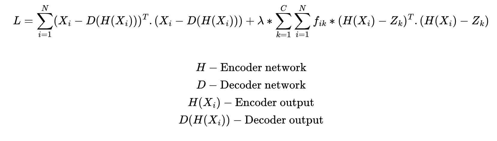
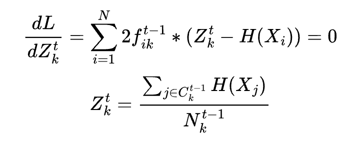

K-Means is probably one of the first standard ML algorithm that an ML engineer learns to implement from scratch. Although K-Means is a very simple and straightforward algorithm to implement but it has a wide range of applicability across different ML related domains such as customer segmentation and churn prediction in marketing, image segmentation in computer vision, grouping similar users and products in recommendation systems and so on. 
<br/><br/>
Ignoring the scaling challenges associated with hundreds of billions of data points, a good enough implementation can be done to cluster millions of points pretty accurately on a single PC. The simplicity of the algorithm lies in its loss function.
<br/><br/>

<br/><br/>
In the above loss function to minimize, each `X(i)` is a `nx1` vector and `Z(k)` is also `nx1` vector. `k` denotes the cluster index and `Z(k)` is the centroid corresponding to cluster `k`. `X(i)` are the data points. `f(i,k)=1` if point `i` belongs to cluster `k` else `f(i,k)=0`. Thus, we minimize the distances of each point to its 'assigned' cluster or in other words, assign the points to clusters so that the total sum of distances of each point to its assigned cluster centroid is minimized. 
<br/><br/>
Note that we have not yet established that 'assigned' means the 'nearest' cluster.
<br/><br/>
Note that the optimization steps involved to minimize the above loss is an `EM-algorithm` (Expectation-Maximization) because to assign points to one of the clusters, I need to know the cluster centroids, but the cluster centroids are not known beforehand and also has to be estimated. In problems such as this, involving chicken-and-egg relation, EM algorithm is a suitable approach provided it goes to convergence. 
<br/><br/>
The idea is to first assume some cluster centroids, find the best assignment and then re-estimate the cluster centroids in the next iteration and so on.
<br/><br/>
```
1. Assume random cluster centroids.
2. Solve for the above assignment problem by minimizing the loss.
3. Re-estimate cluster centroids based on 2.
4. Repeat steps 2 & 3 iteratively until the above loss has not moved by some epsilon.
```
<br/><br/>
In step 2 above, solving for the assignment problem is pretty straightforward because the loss terms are `(X(i)-Z(k))**2` which is the distance of `X(i)` from `Z(k)`. Thus, solving step 2 implies finding the nearest cluster centroid for each point. Another way to look at it is to think of a cost matrix `C[i,k]` with entries equal to `(X(i)-Z(k))**2`. Then from each row take exactly one column such that the total sum of values is minimum. 
<br/><br/>
Without any constraints, this is a classic greedy algorithm problem which is solved by taking the column with the minimum cost from each row.
<br/><br/>
For step 3, once we know the cluster assignments based on step 2 i.e. we now know the values of `f[i,k]`, we can then solve the optimization problem for the unknowns `Z(k)` i.e. cluster centroids. Fortunately, we have a convex optimization problem in our hand with a global minima as follows:
<br/><br/>

<br/><br/>
Thus, it is proven that the updated values for the cluster centroids in iteration `t` is nothing but the average of all the points assigned to that cluster centroid in the previous iteration. Here is a simple Python implementation using vectorised NumPy operations:
<br/><br/>
```python
import numpy as np

def get_initial_centroids(inp:np.ndarray, k:int):
    """
    Get initial centroids.
    """
    rng = np.random.default_rng()
    z = rng.choice(inp, size=k, replace=False, axis=0)
    return z
 
def kmeans(inp:np.ndarray, k:int, num_iters:int):
    """
    Returns cluster centroids and assignments.
    """
    z = get_initial_centroids(inp, k)
    f = None

    for iter in range(num_iters):
        # sum[i,j] (inp[i]-z[j])^T.(inp[i]-z[j])
        a = np.sum(inp**2, axis=1, keepdims=True)
        b = np.sum(z**2, axis=1, keepdims=True)
        c = inp @ z.T

        # d[i,j] - distance of point i from centroid j.
        d = a + b - 2*c

        # loss is the sum of the minimum distances for each point.
        loss = np.min(d, axis=1).sum()
        print(f"Loss at epoch={iter} : {loss}")

        # f is 1 for centroid with minimum distance from point else 0
        f = (d == d.min(axis=1, keepdims=True)).astype(int)

        # g gives the number of points assigned to each centroid
        g = np.sum(f, axis=0, keepdims=True)

        # centroids are the mean of the points assigned to cluster.
        # g.T + 1e-10 small constant added to avoid division by 0.
        z = (f.T @ inp)/(g.T + 1e-10)

    return z, f
```
<br/><br/>
The initial centroids are selected randomly from the existing points but it may not be an optimal approach as the chosen points may all belong to the same cluster. `K-Means++` is a preferred algorithm for selection of initial centroids. The algorithm iteratively selects the centroids such that the next point to select is sampled from points which are far away from existing centroids. A simple Python implementation for K-Means++.
<br/><br/>
```python
import numpy as np
import random

def get_initial_centroids(inp:np.ndarray, k:int):
    """
    Get initial centroids using K-Means++
    """
    centroid_indices = []

    # select 1st point randomly
    centroid_indices += [random.randint(0, inp.shape[0]-1)]

    while len(centroid_indices) < k:
        # select next centroids from remaining points
        non_centroid_indices = list(set(list(range(inp.shape[0])))-set(centroid_indices))
        centroids = inp[centroid_indices,:]

        # find the minimum distance of each point to any cluster.
        inp_h = inp[non_centroid_indices,:]
        a = np.sum(inp_h**2, axis=1, keepdims=True)
        b = np.sum(centroids**2, axis=1, keepdims=True)
        c = inp_h @ centroids.T
        d = a + b - 2*c

        min_distances = np.min(d, axis=1).reshape((d.shape[0],))
        sum_min_distances = np.sum(min_distances)
        min_distances = min_distances/sum_min_distances
        dc = np.cumsum(min_distances)

        # sample uniformly from the distribution of the distances. Higher min distances has higher probabilities of getting sampled.
        u = random.uniform(0.0, 1.0)
        l,r = 0, dc.shape[0]-1
        p = -1
        while l <= r:
            m = int((l+r)/2)
            if u <= dc[m]:
                p = m
                r = m-1
            else:
                l = m+1

        if p == -1:
            break

        centroid_indices += [non_centroid_indices[p]]

    return inp[centroid_indices,:]
```
<br/><br/>
Note that the training did not go through the usual gradient descent or other such optimization routines as we saw in our earlier posts. This is because we could analytically solve for `Z(k)` by setting the derivative of the loss w.r.t. `Z(k)` to 0. Complicating the problem and the loss function a bit here. The next problem deals with `Deep Clustering Networks`. The idea is to learn reduced dimension representations for the input vectors that would be optimized for the clustering problem i.e. learn the embeddings such that the points in the reduced dimension are better clustered around their centroids.
<br/><br/>
If we learn the embeddings separately, it may happen that the points in reduced dimension are "scattered everywhere". But learning the embeddings and the clusters jointly avoids this problem. A lot of problems require reducing the dimensionality of data e.g. high dimensional data (lots of features), sparse vectors etc. Learning the reduced representation through `PCA` or `SVD` does not optimize the downstream problem of clustering or classification. 
<br/><br/>

<br/><br/>
The loss function is composed of two terms 1. reconstruction loss from input vectors and decoder outputs 2. k-means loss same as before. Note that the gradients of the loss w.r.t. the centroids is similar as before, but instead of the original inputs, now the centroids are computed as means over the reduced representations and still do not require gradient descent to compute given the encoder weights. Thus, the centroids can be learnt without backpropagation.
<br/><br/>

<br/><br/>
Common strategy to train such a network is to pre-train the encoder-decoder network first and then fine-tune the encoder-decoder weights based on the centroids. Implementing the training using our autograd framework written in earlier posts for tensors. The full set of forward and backward operators are shared in [this gist](https://gist.github.com/funktor/729fc09db41a3db736729840b3a2dc11). An example of the forward and backward pass for the matrix dot product operation is shown below:
<br/><br/>
```python
class uDotvNode(Node):
    def __init__(self, u:Node, v:Node):
        self.u = u
        self.v = v

    def forward(self, param_vals:np.ndarray):
        # check forward cache
        if self not in NNContext.fwd_cache:
            u_f = self.u.forward(param_vals)
            v_f = self.v.forward(param_vals)
            NNContext.fwd_cache[self] = np.dot(u_f, v_f)

        return NNContext.fwd_cache[self]

    def backward(self):
        # check backward cache
        if self not in NNContext.bwd_cache:
            u_f = NNContext.fwd_cache[self.u]
            v_f = NNContext.fwd_cache[self.v]

            n_u = get_total_shape(u_f.shape)
            m_u = u_f.shape[-1]
            p_u = int(n_u/m_u)

            v_ft = np.swapaxes(v_f, -2, -1)
            n_v = get_total_shape(v_ft.shape)
            m_v = v_ft.shape[-1]
            p_v = int(n_v/m_v)

            a = np.kron(np.eye(p_u, p_u, dtype=np.float32), v_ft)
            b = np.kron(u_f, np.eye(p_v, p_v, dtype=np.float32))

            arr = [[a, b]]

            u_b = self.u.backward()
            v_b = self.v.backward()

            out = u_b + v_b
            NNContext.bwd_cache[self] = tensor_prod(arr, out)

        return NNContext.bwd_cache[self]
```
<br/><br/>
The optimizer used during our training is the Adam optimizer. Here is a simple NumPy based implementation for our custom training framework:
<br/><br/>
```python
class AdamOptim:
    def __init__(self, num_params, learning_rate=0.001):
        self.num_params = num_params

        # NNContext holds the training parameters in a global context
        self.m = [np.zeros(shape=node.shape) for node in NNContext.node_list]
        self.v = [np.zeros(shape=node.shape) for node in NNContext.node_list]
        self.beta_1 = 0.9
        self.beta_2 = 0.999
        self.epsilon = 1e-8
        self.iter = 1
        self.alpha = learning_rate

    def optimize(self, curr_values, gradients):
        for i in range(self.num_params):
            grad = gradients[i].reshape(self.m[i].shape)
            self.m[i] = self.beta_1*self.m[i] + (1-self.beta_1)*grad
            self.v[i] = self.beta_2*self.v[i] + (1-self.beta_2)*grad*grad

            m_alt = self.m[i]/(1-self.beta_1**self.iter)
            v_alt = self.v[i]/(1-self.beta_2**self.iter)

            curr_values[i] -= (self.alpha*m_alt)/(np.sqrt(v_alt) + self.epsilon)

        self.iter += 1
        return curr_values
```
<br/><br/>
Finally the training routine for deep clustering network as follows. The example use 100 points as 16 dimensional vectors which are reduced to 4 dimensions by passing through 2 layers of a deep autoencoder network. The clustering routine clusters the points into 5 clusters. The quality of clusters are evaluated using both the k-means loss function as well as the normalised mutual information score after each epoch. The clusters are generated synthetically with an actual cluster label attached to each point:
<br/><br/>
```python
from sklearn.datasets import make_blobs
from sklearn.metrics import normalized_mutual_info_score
import math, collections

NNContext.init()

n = 100 # number of points
d = 16 # dimensionality of each point
d_0 = 8 # reduced dimensionality at layer 1
d_1 = 4 # final reduced dimensionality at layer 2
k = 5 # number of clusters

learning_rate = 1e-3

# parameter weights for each layer
ws_0 = ParameterNode(shape=(d, d_0))
ws_1 = ParameterNode(shape=(d_0, d_1))

inp = ConstantNode()
z = ConstantNode()

# Autoencoder Network
# l1 and l2 and encoders, l3 and l4 are decoders.

l1 = uDotvNode(inp, ws_0) # n x d_0
l2 = uDotvNode(l1, ws_1) # n x d_1
l3 = uDotvNode(l2, TransposeNode(ws_1, 0, 1)) # n x d_0
l4 = uDotvNode(l3, TransposeNode(ws_0, 0, 1)) # n x d

# Autoencoder optimized using the MSE loss between actual input and output of decoder network
recon = MSENode(inp, l4) # 1 x 1

# Clustering Network
l8  = TransposeNode(z, 0, 1) # Z^T - d_1 x k
l9  = PowerNode(l2, 2.0) # n x d_1
l10 = PowerNode(l8, 2.0) # d_1 x k
l11 = AxisSumNode(l9, 1) # n x 1
l12 = AxisSumNode(l10, 0) # 1 x k
l13 = uDotvNode(l2, l8) # n x k
l14 = SumNode(l11, l12) # n x k
l15 = SumNode(l14, MulConstantNode(l13, -2.0)) # n x k
l16 = SoftmaxNode(MulConstantNode(l15, -1e6)) # n x k
l17 = MulNode(l16, l15) # n x k

# Total cost is reconstruction loss + sum of distances of each point from its nearest centroid.
cost_node = SumNode(recon, SumReduceNode(l17)) # 1 x 1

rng = np.random.default_rng()

# generate synthetic clusters and standardize them.
input, actual_labels = make_blobs(n_samples=n, n_features=d, centers=k, cluster_std=0.6, random_state=42)
input = (input - np.mean(input, axis=0, keepdims=True))/np.std(input, axis=0, keepdims=True)

ws_0_ini = np.random.uniform(low=0.0, high=1.0, size=(d, d_0))
ws_1_ini = np.random.uniform(low=0.0, high=1.0, size=(d_0, d_1))

inp.set_value(input)

optim = AdamOptim(NNContext.num_params, learning_rate=learning_rate)
param_values = [ws_0_ini, ws_1_ini]
z_0 = None

increasing_losses_count = 0
prev_loss = float("Inf")

# Pre-train only the autoencoder network till the loss stabilize over time.
for epoch in range(5000):
    NNContext.reset_cache()
    cost = recon.forward(param_values)
    print(epoch, cost)
    grads = recon.backward()[0]
    param_values = optim.optimize(param_values, grads)

    # Optimize loss till the loss starts to increase for 3 or more epochs.
    if cost > prev_loss:
        increasing_losses_count += 1
    else:
        increasing_losses_count = 0

    if increasing_losses_count >= 3:
        break

    prev_loss = cost

optim = AdamOptim(NNContext.num_params, learning_rate=learning_rate)

increasing_losses_count = 0
prev_loss = float("Inf")

# Joint optimization of autoencoder network + clustering network
for epoch in range(1000):
    NNContext.reset_cache()

    inp_h = l2.forward(param_values)
    if z_0 is None:
        z_0 = get_initial_centroids(inp_h, k)
    z.set_value(z_0)

    # for the synthetic problem, evaluate quality of clusters using normalized mutual information.
    distances = l15.forward(param_values)
    pred_labels = np.argmin(distances, axis=-1)
    score = normalized_mutual_info_score(actual_labels, pred_labels)
    cost = cost_node.forward(param_values)
    print(epoch, cost, score)

    # backpropagation
    grads = cost_node.backward()[0]
    param_values = optim.optimize(param_values, grads)

    # re-compute the centroids
    f = (distances == distances.min(axis=1, keepdims=True)).astype(int)
    g = np.sum(f, axis=0, keepdims=True)
    z_0 = (f.T @ inp_h)/(g.T + 1e-10)

    # Optimize loss till the loss starts to increase for 3 or more epochs.
    if cost > prev_loss:
        increasing_losses_count += 1
    else:
        increasing_losses_count = 0

    if increasing_losses_count >= 3:
        break

    prev_loss = cost
```
<br/><br/>
One can experimentally verify that the reduced representations after pre-training alone is sub-optimal for clustering by computing the `normalized_mutual_info_score` after pre-training vs. after fine-tuning with the updated centroids. The above implementation can also be compared against the K-Means library in scikit-learn package with the same input vectors as the deep clustering network's encoder representations.
<br/><br/>
```python
from sklearn.cluster import KMeans

kmeans = KMeans(
    n_clusters=k,
    init="k-means++",
    n_init="auto",  # Runs algorithm multiple times to pick best centroids
    random_state=42,  # Ensures reproducible results
)

inp_h = l2.forward(param_values)
y_pred = kmeans.fit_predict(inp_h)
score = normalized_mutual_info_score(actual_labels, y_pred)
print(score)
```
<br/><br/>
Based on the results from the K-Means library and the custom deep clustering network, the final `NMI` score seems to agree.
